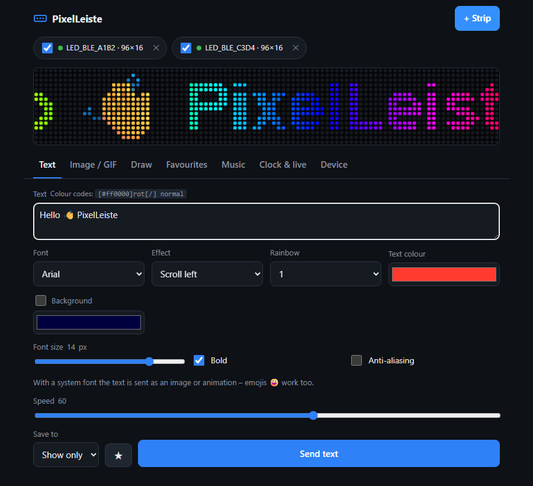
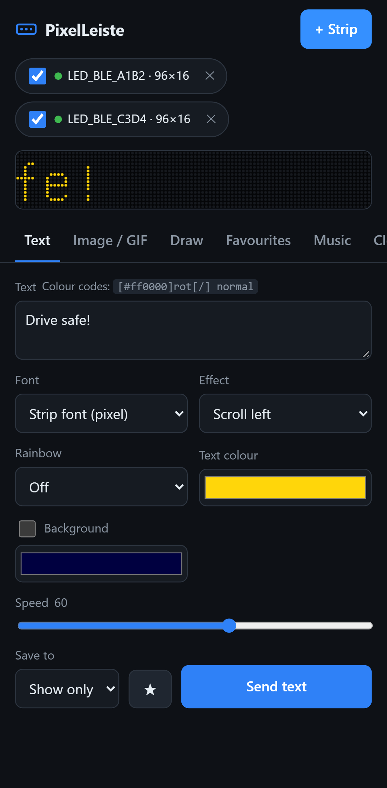
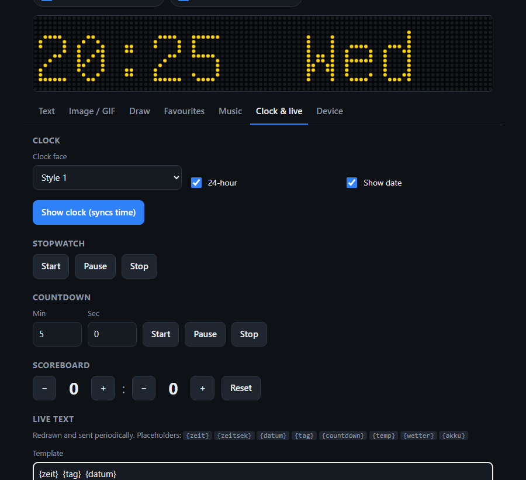
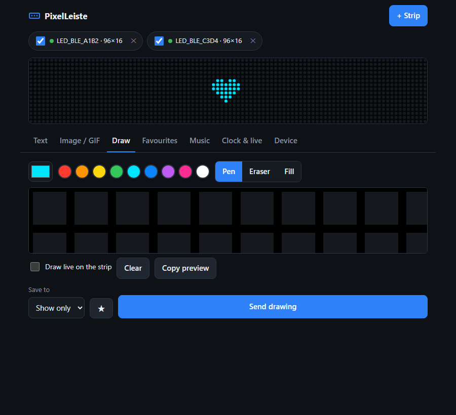

# PixelLeiste

[Deutsch](README_de.md) · **English**

App for **Windows, Linux and Android** plus a **Home Assistant integration** for LED strips and
matrices of the **“iPixel Color” family** – e.g. the AliExpress strip **TR5645H135-08H (16×96)**.
USB only powers the strip; it is controlled via **Bluetooth LE** (device name usually `LED_BLE_…`).
No cloud, no account, no ads.

<p>
  
  
</p>

## Features

| Area | What you can do |
|---|---|
| **Text** | Strip font (pixel) with scrolling, blinking, breathing, snowflakes, 9 rainbow styles · **system fonts** (Arial, Impact …) with size/bold, **emojis** 😀 · colour codes in the text: `[#ff0000]red[/] normal` |
| **Image / GIF** | PNG, JPG, WebP, BMP and animated GIFs, scaled to the panel size automatically |
| **Draw** | Pixel editor with pen, eraser, fill · “draw live” sends every pixel immediately |
| **Favourites & profiles** | Save texts, images and drawings with ★; load several favourites as a profile (“Car”, “Party” …) into slots 1–10 in one go |
| **Music** | Equaliser driven by the phone’s/PC’s microphone · built-in rhythm effect |
| **Clock & live** | 9 clock faces, stopwatch, countdown, scoreboard · live text with `{zeit}` (time), `{datum}` (date), `{tag}` (weekday), `{countdown}`, `{temp}`, `{wetter}` (weather), `{akku}` (battery) and on Windows `{cpu}`, `{ram}` · **Android:** notifications (e.g. WhatsApp) as scrolling text |
| **Device** | On/off, brightness, orientation, slots, **password protection** |
| **Connection** | **Several strips at once** · known strips **connect automatically** on start and reconnect after a drop-out |
| **App** | German / English · **update check** (Windows updates itself) |

<p>
  
  
</p>

## Installation

Downloads: **[Releases](https://github.com/phillhf/PixelLeiste/releases/latest)**.

**Windows** (10/11 with Bluetooth, built-in or a USB dongle): download and run
`PixelLeiste-Setup-<version>.exe`. No administrator rights needed; Start menu entry and optional
desktop shortcut; detects an existing installation (update). Uninstall via “Apps” – you can choose to
keep your settings. PixelLeiste can install new versions itself.
Silent install: `PixelLeiste-Setup-<version>.exe /VERYSILENT [/DIR="D:\PixelLeiste"] [/TASKS="desktopicon"]`

> Windows SmartScreen may show “Unknown publisher” on first start – the setup is not code-signed
> with a paid certificate. Click “More info → Run anyway”.

**Linux** (Debian, Ubuntu, Mint … 64-bit, with Bluetooth/BlueZ):

```bash
sudo apt install ./pixelleiste_<version>_amd64.deb
```

Then start “PixelLeiste” from the application menu. Or without installing: make
`PixelLeiste-<version>-x86_64.AppImage` executable (`chmod +x`) and run it. Updates: the AppImage
replaces itself; the .deb version downloads the verified package and opens it in the software
centre. Same features as on Windows.

**Android** (6.0+): open `PixelLeiste-<version>.apk` on the phone and allow “install unknown apps”.
New versions install right over it. Permissions: “Nearby devices” (Bluetooth), microphone only for
the equaliser, notification access only if you turn on the notification display.

## Usage

1. Power the strip via USB. **Close the “iPixel Color” phone app** – the strip accepts only one
   Bluetooth connection at a time.
2. Press **Connect** and choose `LED_BLE_…`. Add more strips with **+ Strip**; the tick box on each
   strip selects which ones receive content.
3. Set up text, image or drawing – the preview at the top shows the result – and send it.

If the strip does not show up: tick “Show all Bluetooth devices” under *Device → Connection*.
The **log** under *Device* helps with troubleshooting.

## Home Assistant

The **PixelLeiste** integration controls the strip directly from Home Assistant – through its
Bluetooth adapter or an [ESPHome Bluetooth proxy](https://esphome.io/components/bluetooth_proxy.html)
near the strip. The app does not need to run.

**Install via HACS:** HACS → ⋮ → *Custom repositories* → `https://github.com/phillhf/PixelLeiste`,
type *Integration* → download “PixelLeiste” → restart Home Assistant. (Without HACS: copy
`custom_components/pixelleiste` to `/config/custom_components/`.)

**Setup:** Home Assistant discovers switched-on strips (`LED_BLE_…`) automatically under
*Settings → Devices & services*; or *Add integration → PixelLeiste*. The integration options hold the
strip’s **password** and the idle time before disconnecting.

> The strip accepts only **one** Bluetooth connection at a time. Home Assistant therefore connects
> only while sending and releases the strip after 30 seconds without commands – then the phone or
> PC app can connect too.

**Entities:** *Panel* (light: on/off, brightness), *Text* (type a text → it is sent), *Text effect*,
*Text colour*, *Text speed*, *Clock face*, *Show slot*, buttons *Show clock* and *Sync time*.

**Actions** for automations: `pixelleiste.send_text`, `send_image` (file or URL, GIFs too),
`show_clock`, `show_slot`, `delete_slot`, `scoreboard`, `countdown`, `stopwatch`, `rhythm`,
`set_orientation`. Example – the doorbell shows a notice, then slot 1 again:

```yaml
automation:
  - alias: Doorbell on the LED strip
    triggers:
      - trigger: state
        entity_id: binary_sensor.doorbell
        to: "on"
    actions:
      - action: pixelleiste.send_text
        data:
          device_id: 0123456789abcdef   # just pick the strip in the action editor
          text: "Someone is at the door!"
          effect: blink
          color: [255, 80, 0]
      - delay: "00:00:20"
      - action: pixelleiste.show_slot
        data:
          device_id: 0123456789abcdef
          slot: 1
```

For `send_image` with a file the folder must be allowed, e.g.
`homeassistant: allowlist_external_dirs: [/config/www]`.

## Development

One code base (TypeScript + Vite) for both platforms – see [README_de.md](README_de.md#entwicklung)
for the folder overview.

```bash
npm install
npm run dev          # UI in the browser (Chrome/Edge can connect directly via Web Bluetooth)
npm test             # protocol and translation tests
npx playwright test  # UI tests against simulated strips (desktop + phone)
npm run dist:win     # Windows setup into release/ (needs Inno Setup 6)
npm run dist:linux   # .deb and AppImage into release/ (build on Linux)
pytest               # Home Assistant tests (Linux, Python 3.13 + pytest-homeassistant-custom-component)
npm run android:apk  # debug APK (needs JAVA_HOME = JDK 17+ and ANDROID_HOME)
```

**Releasing:** bump the version in `package.json`, commit, push and publish a GitHub release tagged
`v<version>` (also bump `custom_components/pixelleiste/manifest.json`).
`.github/workflows/release.yml` builds the setup, .deb, AppImage and the signed APK (with `.sha256`)
and attaches them. APK signing uses the secrets `PIXELLEISTE_KEYSTORE_BASE64` and
`PIXELLEISTE_KEYSTORE_PASSWORD`. Regenerate screenshots: `SCREENSHOTS=1 npx playwright test screenshots`.

## Credits & licence

MIT licence. The Bluetooth protocol is based on the reverse-engineering work of
[pypixelcolor](https://github.com/lucagoc/pypixelcolor) (MIT) and
[hass-ble-led-sign](https://github.com/eigger/hass-ble-led-sign); the generated commands are tested
byte-for-byte against pypixelcolor. Pixel font: GNU Unifont (SIL OFL 1.1).
Weather data: [Open-Meteo](https://open-meteo.com) (CC BY 4.0).

Some settings (orientation, the clock’s 24 h switch, scoreboard) follow community documentation;
individual firmware versions may behave differently.
