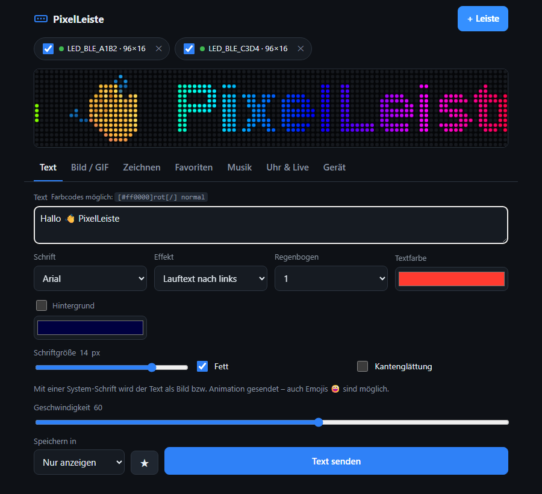
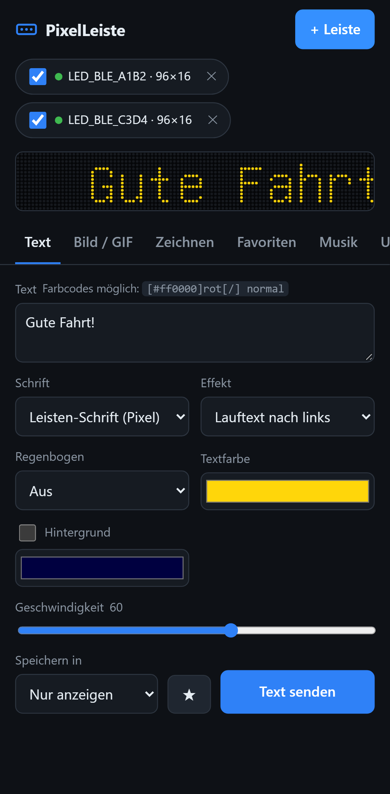
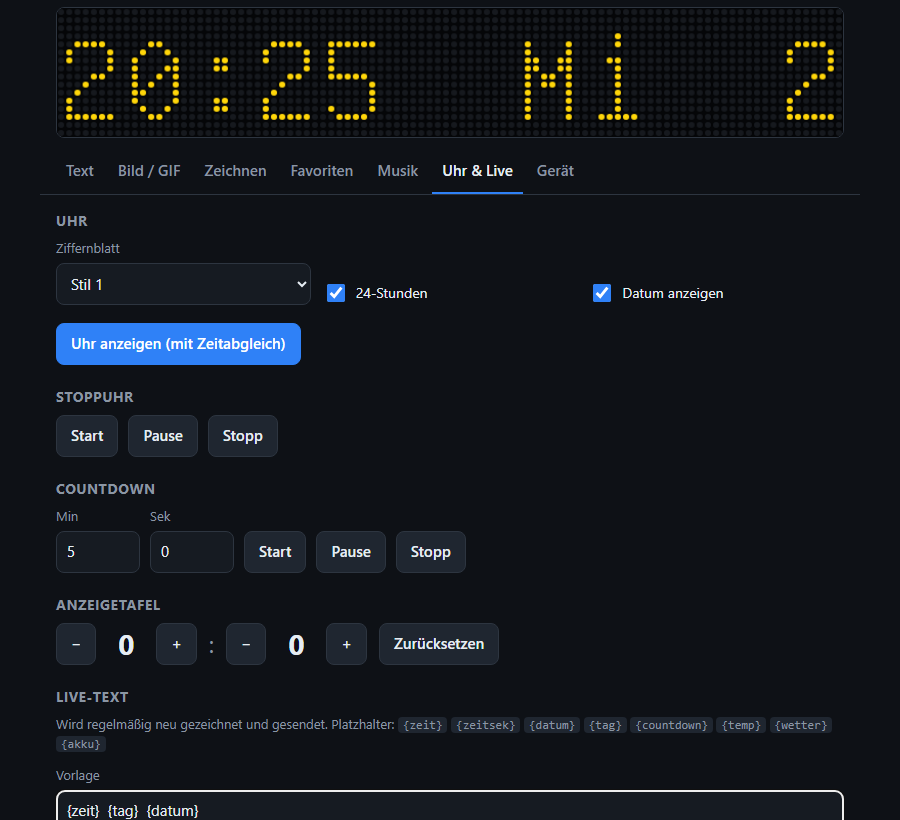
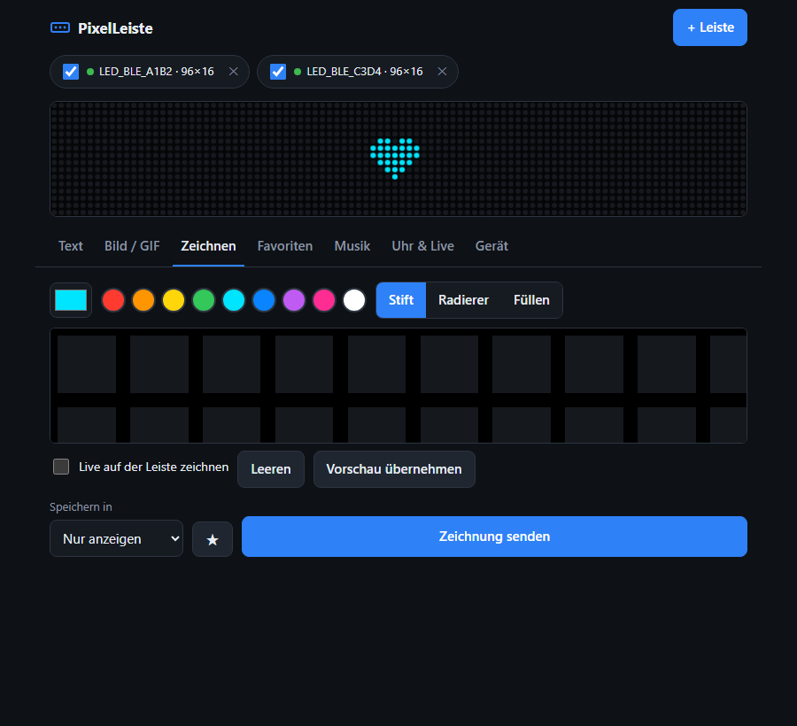

# PixelLeiste

**Deutsch** · [English](README.md)

App für **Windows, Linux und Android** sowie eine **Home-Assistant-Integration** für LED-Leisten und
-Matrizen der **„iPixel Color“-Familie** – z. B. die AliExpress-Leiste **TR5645H135-08H (16×96)**.
Die Leiste bekommt über USB nur Strom; gesteuert wird sie per **Bluetooth LE** (Gerätename meist
`LED_BLE_…`). Keine Cloud, kein Konto, keine Werbung.

<p>
  
  
</p>

## Funktionen

| Bereich | Was geht |
|---|---|
| **Text** | Leisten-Schrift (Pixel) mit Lauftext, Blinken, Atmen, Schneeflocken, 9 Regenbogen-Stilen · **System-Schriften** (Arial, Impact …) in Größe/fett, **Emojis** 😀 · Farbcodes im Text: `[#ff0000]rot[/] normal` |
| **Bild / GIF** | PNG, JPG, WebP, BMP und animierte GIFs, automatisch auf die Panelgröße skaliert |
| **Zeichnen** | Pixel-Editor mit Stift, Radierer, Füllen · „Live zeichnen“ überträgt jeden Pixel sofort |
| **Favoriten & Profile** | Texte, Bilder und Zeichnungen mit ★ speichern; mehrere Favoriten als Profil („Auto“, „Party“ …) auf einmal in die Speicherplätze 1–10 laden |
| **Musik** | Equalizer über das Mikrofon des Handys/PCs im Takt der Musik · eingebauter Rhythmus-Effekt |
| **Uhr & Live** | 9 Uhr-Stile, Stoppuhr, Countdown, Anzeigetafel · Live-Text mit `{zeit}`, `{datum}`, `{tag}`, `{countdown}`, `{temp}`, `{wetter}`, `{akku}` und unter Windows/Linux `{cpu}`, `{ram}` |
| **Gerät** | Ein/Aus, Helligkeit, Ausrichtung, Speicherplätze, **Passwortschutz** |
| **Verbindung** | **Mehrere Leisten gleichzeitig** · bekannte Leisten werden beim Start **automatisch verbunden** und nach einem Abbruch neu verbunden |
| **App** | Deutsch / Englisch · **Update-Prüfung** (Windows aktualisiert sich selbst) |

<p>
  
  
</p>

## Installation

Downloads unter **[Releases](https://github.com/phillhf/PixelLeiste/releases/latest)**.

**Windows** (10/11 mit Bluetooth, eingebaut oder USB-Stick): `PixelLeiste-Setup-<Version>.exe`
herunterladen und starten. Keine Administratorrechte nötig, Startmenü-Eintrag und optional
Desktop-Verknüpfung, erkennt vorhandene Installationen (Update). Deinstallation über „Apps“ – dabei
kannst du wählen, ob die Einstellungen bleiben. Neue Versionen installiert PixelLeiste auf Wunsch selbst.
Stille Installation: `PixelLeiste-Setup-<Version>.exe /VERYSILENT [/DIR="D:\PixelLeiste"] [/TASKS="desktopicon"]`

> Windows SmartScreen zeigt beim ersten Start evtl. „Unbekannter Herausgeber“ – das Setup ist nicht
> kostenpflichtig code-signiert. „Weitere Informationen → Trotzdem ausführen“.

**Linux** (Debian, Ubuntu, Mint … 64 Bit, mit Bluetooth/BlueZ):

```bash
sudo apt install ./pixelleiste_<Version>_amd64.deb
```

Danach „PixelLeiste“ im Anwendungsmenü starten. Alternativ ohne Installation:
`PixelLeiste-<Version>-x86_64.AppImage` ausführbar machen (`chmod +x`) und starten. Updates: Das
AppImage ersetzt sich selbst; bei der .deb-Version lädt die App das geprüfte Paket und öffnet es im
Software-Center. Funktionsumfang wie unter Windows.

**Android** (ab 6.0): `PixelLeiste-<Version>.apk` auf dem Handy öffnen und „Installation aus
unbekannten Quellen“ erlauben. Neue Versionen lassen sich direkt darüber installieren.
Berechtigungen: „Geräte in der Nähe“ (Bluetooth), Mikrofon nur für den Equalizer.

## Bedienung

1. Leiste per USB mit Strom versorgen. **Die Handy-App „iPixel Color“ schließen** – die Leiste
   akzeptiert nur eine Bluetooth-Verbindung gleichzeitig.
2. **Verbinden** drücken und `LED_BLE_…` auswählen. Weitere Leisten mit **+ Leiste** hinzufügen; mit
   dem Häkchen am Gerät wählst du, welche Leisten Inhalte bekommen.
3. Text, Bild oder Zeichnung einstellen – die Vorschau oben zeigt das Ergebnis – und senden.

Taucht die Leiste nicht auf: unter *Gerät → Verbindung* „Alle Bluetooth-Geräte zeigen“ anhaken.
Das **Protokoll** unter *Gerät* hilft bei der Fehlersuche.

## Home Assistant

Die Integration **PixelLeiste** steuert die Leiste direkt aus Home Assistant – über dessen
Bluetooth-Adapter oder einen [ESPHome-Bluetooth-Proxy](https://esphome.io/components/bluetooth_proxy.html)
in der Nähe der Leiste. Die App muss dafür nicht laufen.

**Installation über HACS:** HACS → ⋮ → *Benutzerdefinierte Repositories* →
`https://github.com/phillhf/PixelLeiste`, Typ *Integration* → „PixelLeiste“ herunterladen →
Home Assistant neu starten. (Ohne HACS: Ordner `custom_components/pixelleiste` nach
`/config/custom_components/` kopieren.)

**Einrichten:** Home Assistant erkennt eingeschaltete Leisten (`LED_BLE_…`) automatisch und schlägt
sie unter *Einstellungen → Geräte & Dienste* vor; alternativ *Integration hinzufügen → PixelLeiste*.
In den Optionen der Integration lassen sich das **Passwort** der Leiste und die Zeit bis zum
Trennen einstellen.

> Die Leiste nimmt nur **eine** Bluetooth-Verbindung gleichzeitig an. Home Assistant verbindet sich
> deshalb nur, wenn es etwas sendet, und gibt die Leiste nach 30 Sekunden ohne Befehl wieder frei –
> danach kann sich auch die Handy- oder PC-App verbinden.

**Entitäten:** *Leiste* (Licht: an/aus, Helligkeit), *Text* (Text eintippen → wird gesendet),
*Texteffekt*, *Textfarbe*, *Textgeschwindigkeit*, *Ziffernblatt*, *Speicherplatz anzeigen*,
Tasten *Uhr anzeigen* und *Uhrzeit übertragen*.

**Aktionen** für Automationen: `pixelleiste.send_text`, `send_image` (Datei oder URL, auch GIF),
`show_clock`, `show_slot`, `delete_slot`, `scoreboard`, `countdown`, `stopwatch`, `rhythm`,
`set_orientation`. Beispiel – Klingel zeigt einen Hinweis und danach wieder Speicherplatz 1:

```yaml
automation:
  - alias: Klingel auf der LED-Leiste
    triggers:
      - trigger: state
        entity_id: binary_sensor.klingel
        to: "on"
    actions:
      - action: pixelleiste.send_text
        data:
          device_id: 0123456789abcdef   # im Aktions-Editor einfach die Leiste auswählen
          text: "Es hat geklingelt!"
          effect: blink
          color: [255, 80, 0]
      - delay: "00:00:20"
      - action: pixelleiste.show_slot
        data:
          device_id: 0123456789abcdef
          slot: 1
```

Für `send_image` mit einer Datei muss der Ordner in Home Assistant freigegeben sein, z. B.
`homeassistant: allowlist_external_dirs: [/config/www]`.

## Entwicklung

Eine Codebasis (TypeScript + Vite) für beide Plattformen:

| Pfad | Inhalt |
|---|---|
| `src/protocol/ipixel.ts` | Byte-Protokoll (Befehle, 12-KB-Fenster, CRC32, Zeichen-Bitmaps) |
| `src/ble/` | BLE-Verbindung (ACKs, 244-Byte-Pakete) und Verwaltung mehrerer Leisten |
| `src/render/` | Pixelschrift (GNU Unifont), System-Schriften, Bild-/GIF-Kodierung |
| `src/features/` | die einzelnen Bereiche der Oberfläche |
| `src/i18n.ts` | Übersetzungen (Deutsch ist die Quellsprache) |
| `electron/` | Desktop-Hülle (Windows/Linux): Geräteauswahl, Auto-Verbinden, Selbst-Update |
| `custom_components/pixelleiste/` | Home-Assistant-Integration (Python-Portierung des Protokolls) |
| `tests_ha/` | Tests der Integration (Protokoll, Einrichtung, Entitäten, Aktionen) |
| `android/` | Capacitor-Android-Projekt |
| `installer/` | Inno-Setup-Skript und Build-Skript |
| `e2e/` | Playwright-Tests gegen simulierte Leisten (`mock-ble.js`) |

```bash
npm install
npm run dev          # Oberfläche im Browser (Chrome/Edge verbinden sich per Web Bluetooth direkt)
npm test             # Protokoll- und Übersetzungstests
npx playwright test  # Oberflächentests mit simulierten Leisten (Desktop + Handy)
npm run dist:win     # Windows-Setup nach release/ (benötigt Inno Setup 6)
npm run dist:linux   # .deb und AppImage nach release/ (auf Linux bauen)
pytest               # Home-Assistant-Tests (Linux, Python 3.13 + pytest-homeassistant-custom-component)
npm run android:apk  # Debug-APK (benötigt JAVA_HOME = JDK 17+ und ANDROID_HOME)
```

**Release erstellen:** Version in `package.json` erhöhen, committen, pushen und auf GitHub eine
Release mit dem Tag `v<Version>` veröffentlichen (Version auch in
`custom_components/pixelleiste/manifest.json`). `.github/workflows/release.yml` baut dann Setup,
.deb, AppImage und signierte APK (inkl. `.sha256`) und hängt sie an. Die APK-Signatur kommt aus den Secrets
`PIXELLEISTE_KEYSTORE_BASE64` und `PIXELLEISTE_KEYSTORE_PASSWORD`.
Screenshots neu erzeugen: `SCREENSHOTS=1 npx playwright test screenshots`.

## Danksagung & Lizenz

MIT-Lizenz. Das Bluetooth-Protokoll basiert auf der Reverse-Engineering-Arbeit von
[pypixelcolor](https://github.com/lucagoc/pypixelcolor) (MIT) und
[hass-ble-led-sign](https://github.com/eigger/hass-ble-led-sign); die erzeugten Befehle sind per Tests
byte-genau gegen pypixelcolor geprüft. Pixelschrift: GNU Unifont (SIL OFL 1.1).
Wetterdaten: [Open-Meteo](https://open-meteo.com) (CC BY 4.0).

Einige Einstellungen (Ausrichtung, 24h-Schalter der Uhr, Anzeigetafel) folgen der
Community-Dokumentation; einzelne Firmware-Versionen können sich anders verhalten.
